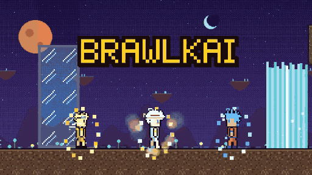

# Brawlkai

<p align="center">
  <a href="trailer/trailer.mp4"></a>
</p>

<p align="center">
  <a href="trailer/trailer.mp4"><b>&#9654; Watch the full trailer (27 s, with sound)</b></a>
  &nbsp;&middot;&nbsp;
  <a href="https://supa-figh.vercel.app"><b>Play it free in your browser</b></a>
</p>

A chaotic pixel-art party brawler for the browser. You can have up to 10 fighters: up to 4 local humans on
keyboards or gamepads, and the rest are bots. Fight on platform maps with guns, melee weapons, explosives,
gadgets and physics props. Rounds are short and restarts are instant, so there's never any waiting around.

All art, sound and music are generated procedurally when the game starts. There are no asset files.

## Playing

Open the game. The main menu has a card for each keyboard player and a quick-match panel:
- **Name:** press Enter on NAME and type (up to 8 characters). Names show above heads, in the HUD and in the kill feed.
- **Fighter:** pick SCRAPPER (customize the look in Match Setup) or an anime hero: **Goku**, **Naruto** or **Luffy**.
  The card shows an animated preview of the fighter's signature move.
- **Map** (or RANDOM), **Players** (1 or 2 on the keyboard), **Bots** (0–8) and **Bot skill**. The selected map's
  backdrop and minimap show up right in the menu.
- **Quick Match** starts with those settings (0–8 and Tab still work as shortcuts).
- **Match Setup** opens the lobby. There you set the players, teams, map, mode, rounds and chaos cards.
- **Controls** lets you rebind every action for both keyboard layouts and up to 4 gamepads.
- **Settings** covers volumes, screen shake, gore, damage numbers, replays and fullscreen.

On a gamepad, press START in the lobby to join.

### Default controls
| Action | P1 | P2 (numpad) | P2 (laptop) | Gamepad |
|---|---|---|---|---|
| Move / aim | W A S D | Arrows | Arrows | Left stick / D-pad |
| Jump (there is no jump key: Up jumps) | **W** | **Up** | **Up** | A |
| Drop through a platform | **S S** (double tap) | **Down Down** | **Down Down** | Down Down |
| Attack (hold = aim) | F | Num4 | L | X / RT |
| Kick (heroes: ability 2) | H | Num6 | J | B |
| Interact (pick up / grab / throw) | T | Num8 | O | Y |
| Cycle weapon | R | Num7 | I | RB |
| Use gadget | V | Num9 | U | LB |
| Hero ability 1 (both = super) | B | Num1 | P | LT |

Pause with Esc or Start (P too, if nobody has it bound).

**W / Up is the jump button** (the keyboard has no separate jump key): ground jump, double jump, wall jump, and a
short tap is a short hop. Up still climbs ladders, climbs ledges and sweeps your aim while you hold Attack (it
never jumps then).

**Guns:** hold Attack to aim (Up and Down sweep the angle and never jump), or tap it for a hip shot.

**Combo:** Attack three times for punch, punch, punch, then a kicking finisher.

**Movement:**
- Run, then press Down to roll.
- Jump again in the air to double jump.
- Jump off walls to wall jump.
- Double-tap a direction to sprint.
- Double-tap Down to drop through a platform (a long crouch never drops you).

**Interact:** grab an enemy, then press Attack to throw them.

### Anime heroes
Pick **Goku**, **Naruto** or **Luffy** on the main menu. Heroes have three moves and a ladder of forms:

| | Goku | Naruto | Luffy |
|---|---|---|---|
| Combo | punch, punch, punch, **kick** | same | same (stretchy) |
| **Ability** key | Instant Transmission (teleport, strikes on arrival) | Rasengan (dash strike; hold to keep going until you hit) | Gum-Gum Pistol (stretching arm, no damage: hold to reach far, grabs platforms / ladders / walls and pulls you, swings from ceilings; 3 charges, each refills 2 s after use) |
| **Kick** key = ability 2 | Kamehameha (hold to charge) | Shadow clones: real fighters that use the Rasengan and look like his current form (2, +1 per form; press again to recall) | Gum-Gum Gatling |
| Movement | Flies in every form (hold Up) | Walks and runs up walls (hold toward a wall + Up); final form flies | Final form flies |
| **Both** keys = super (transformed only) | Spirit Bomb (gathers overhead, then throws an explosive energy ball) | Tailed Beast Bomb | Giant fist (size doubles and range grows with each Gear) |
| Forms (one **power orb** each) | Super Saiyan, SSJ2, SSJ3, Super Saiyan Blue | Crimson aura (one tail), four-tail cloak, six-tail (black), Kurama mode (gold, no tails) | Gear 2, 3, 4, 5 |

Power orbs are the only pickup: a couple appear on the map every ~15 s. Every orb a hero eats takes them up one form
(stronger, faster, bigger aura, a stronger super with a new name) and adds a stacked **form health** bar above their
normal health (one layer of 30 per form). Forms never time out: hits drain the form layers first and the form wears off
when they are gone. Transforming plays one shared animation (flicker, converging energy, shockwave, pillar of light).
Naruto runs on all fours in forms 1-3 (form 1's tail is made of crimson aura) and is upright without tails as Kurama.
Holding Up in the air flies for **Goku in every form** and in the **final forms of Naruto and Luffy**. Scrapyard fighters
just get a short timed boost. Quick match link: `?heroes=naruto,luffy,goku`.

### Modes
- **Brawl:** rounds, last fighter standing. The dead come back as ghosts who can shove things around.
- **Deathmatch:** timed, with respawns.
- **King of the Hill:** hold the hill alone to score.
- **Juggernaut:** one 400 HP minigunner. Kill them to take over.
- **Gun Game:** climb a 12-weapon ladder. The final kill has to be made with a knife.
- **Co-op Survival:** humans against waves of bots, with shared lives and revives. There's a boss every 5 waves.

## Playing together on a LAN

Friends on the same WiFi can play together or against each other from different devices (laptops, phones, tablets).
One computer runs the game server; everyone else just opens a web address.

**On the host computer:**
```
npm install      # once
npm run host     # builds the game, then serves it on port 8080
```
It prints the addresses (and a QR code) for your network, for example `http://192.168.0.227:8080`.

**On every device:** open that address (scan the QR code with a phone), then:
- the host picks **HOST GAME** on the title screen. The room code is shown at the top;
- everyone else picks **JOIN GAME** and chooses the room from the list (or types its 4-letter code);
- each device brings its first player automatically (a laptop can add a second one in the lobby; phones bring one);
- the host picks map, mode, rounds / time, bots and rules, everyone presses **READY**, the host presses **START MATCH**.

The server runs the whole match, bots included. Devices only send their controls and draw what they get back, so a
slow phone cannot slow anybody else down. If a device drops, a bot plays its fighter until it reconnects (just wait, or
reload the page: the game remembers the device and puts it back in the room). If the host leaves, another device
becomes the host. You can keep playing as long as the host's server keeps running.

Single-device play is unchanged: Quick Match and Match Setup do not use the server at all.

### If friends can't join
The game shows a checklist when it can't connect. In order of how often each one is the problem:
1. **The server isn't running.** `npm run host` must still be running in a terminal on the host computer.
2. **Different networks.** Everyone must be on the same WiFi, not a guest network and not mobile data.
3. **Router client isolation.** Many routers (and every "guest" WiFi) block devices from talking to each other. Look for
   *AP isolation*, *client isolation* or *guest network* in the router settings and turn it off.
4. **Host firewall.** The first time you run it, Windows asks whether to let Node.js through the firewall: allow it on
   **Private** networks. If you clicked Cancel: Windows Security > Firewall & network protection > Allow an app through
   firewall > Node.js JavaScript Runtime > tick *Private*. On macOS allow incoming connections for `node`; on Linux
   open the port (for example `sudo ufw allow 8080/tcp`).
5. **Wrong address.** Use the address the host prints (`192.168.x.x` / `10.x.x.x`), not `localhost`, which means "this
   device" on every device. Try `http://<host-ip>:8080/health`: it should say `ok`.
6. **The port is taken.** `npm run host -- --port 9000`.

### HTTPS mode (gamepads and screen wake-lock on other devices)
Over plain `http://` on a LAN address, browsers treat the page as "not secure" and switch off or restrict a few APIs. The
game works without them: **screen wake-lock is not available (phones may dim or lock mid-match: set the screen timeout to
"never" while you play) and gamepads on other devices may not be detected** (it depends on the browser). The host computer itself opens `localhost`, which counts as secure.
To get those APIs on the other devices, serve the game over https with a certificate they trust, made with
[mkcert](https://github.com/FiloSottile/mkcert):
```
mkcert -install                      # once: creates a local certificate authority on the host
mkdir certs
mkcert -cert-file certs/host.pem -key-file certs/host-key.pem localhost 127.0.0.1 192.168.0.227   # your LAN IP(s)
npm run host -- --https
```
Then each phone / laptop must trust mkcert's root CA: copy `rootCA.pem` (`mkcert -CAROOT` shows the folder) to the device
and install it (iOS: AirDrop it, Settings > Profile Downloaded > Install, then Settings > General > About > Certificate
Trust Settings > enable it; Android: Settings > Security > Install a certificate > CA certificate). The `certs/` folder is
git-ignored; never share `rootCA-key.pem`.

### Options
`npm run host -- <options>`

| option | meaning |
|---|---|
| `--port 8080` | port for the game and the server |
| `--no-build` | serve the existing `dist/` without rebuilding |
| `--https` `--cert f` `--key f` | https / wss (defaults: `certs/host.pem`, `certs/host-key.pem`) |
| `--latency 80 --jitter 30 --loss 5` | pretend the network is bad: milliseconds each way, extra random milliseconds, percent of snapshots / controls lost |
| `--speed 4` | run matches faster than real time (soak tests) |

`npm run server` starts only the game server (port 8080, `PORT=9000 npm run server`), for developing against `npm run dev`:
open the dev page with `?server=ws://<host-ip>:8080`.

How good does it feel? With no prediction (everything is shown as the server sees it) a key press shows up on screen
after about 180 ms on good WiFi (three frames of travel, snapshot rate and a ~70 ms smoothing buffer), ~350 ms on a
busy network (60 ms each way, 5% loss) and ~620 ms on an awful one. That is fine for a party brawler on a home network.
The simulation cannot be made faster than your WiFi, so for the best feel put the host on Ethernet and everyone on 5 GHz.

## Development
```
npm install
npm run dev        # http://localhost:5173
npm test           # unit tests (pure simulation, Node)
npm run test:e2e   # Playwright browser tests (PW_EXECUTABLE=/path/to/chrome to use an installed browser)
npm run build      # typecheck + production build into dist/
npm run host       # LAN multiplayer: build, serve the game + game server on the LAN, print URLs + QR code
npm run server     # the game server alone (LAN multiplayer development)
npm run sim -- 8 8 factory normal 1   # headless bot matches: kills per weapon, round lengths
npm run balance -- 2 normal 1        # bot survey across every map
```
The stack is Phaser 3, TypeScript and Vite. The game simulation (`src/sim`) is deterministic, runs at a fixed
60 Hz and never imports Phaser, so it also runs headless for tests, bot balance sims and instant replays.

To get started with the code:
- `CLAUDE.md` describes the architecture and conventions.
- `PROGRESS.md` tracks the milestones.
- `DECISIONS.md` explains the reasoning behind design choices.
- `docs/DEPLOY.md` covers hosting.
- LAN multiplayer: the shared protocol and snapshot code is in `src/net/`, the Node server in `server/`; decisions D70-D76.

Useful URL parameters:
- `?scene=match&map=mine&bots=6&diff=hard&mode=koth&chaos=1`
- `?scene=lobby`
- `?scene=art&page=weapons` (or `&page=heroes`)
- `&speed=4`
- `&seed=N`
